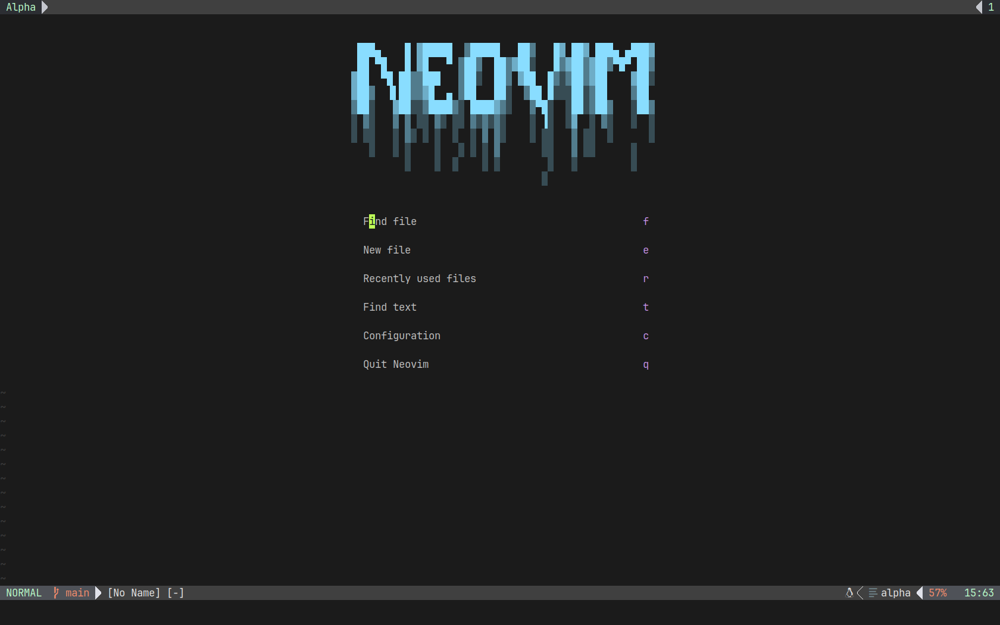
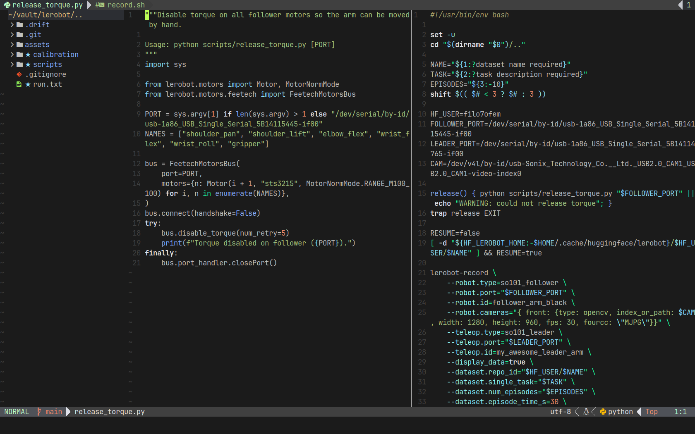
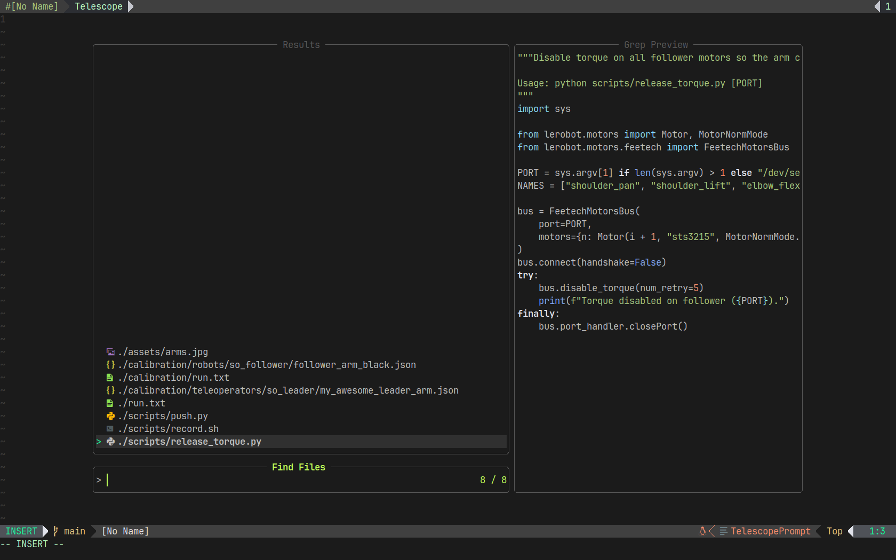
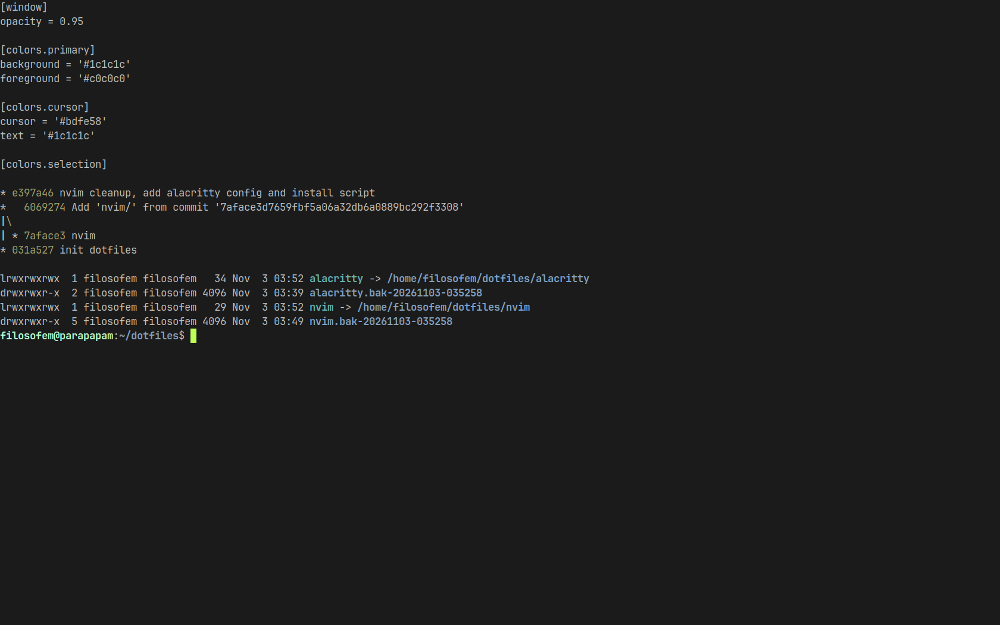

# Mike's dotfiles

Neovim + Alacritty, darkvoid colorscheme, JetBrainsMono Nerd Font.

<table>
  <tr>
    <td width="50%"></td>
    <td width="50%"></td>
  </tr>
  <tr>
    <td align="center"><b>Dashboard</b> (alpha-nvim)</td>
    <td align="center"><b>Editing</b>: nvim-tree, splits, LSP, lualine</td>
  </tr>
  <tr>
    <td width="50%"></td>
    <td width="50%"></td>
  </tr>
  <tr>
    <td align="center"><b>Telescope</b> file finder (<code>,ff</code> / <code>Ctrl+p</code>)</td>
    <td align="center"><b>Alacritty</b></td>
  </tr>
</table>

